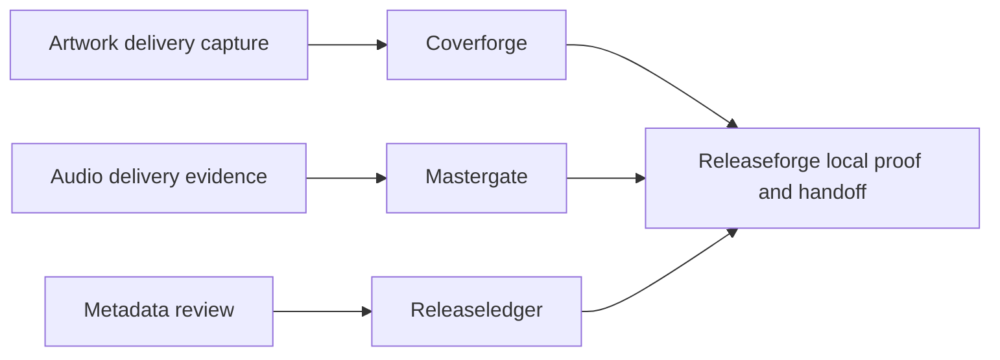

# Gabriel García Alonso

Berlin-based sound engineer, music producer, and hardware-live performer. I
build local-first tools for the practical work around independent music:
preparing a release, checking delivery material, reviewing artwork, and making
handoffs easier to understand.

## Start here

The strongest current experiment is **[Releaseforge](https://github.com/notgabriels-sys/releaseforge/pull/1)**:
a local proof workflow for the point before a delivery handoff or distributor
upload. It is under draft review, so the useful first step is its synthetic
local demo rather than a claim of a finished service.

→ **[Open the safe start-here guide](START_HERE.md)**

## One workflow, four local evidence lanes

The arrows show one possible local evidence flow, not automatic integration, a
mandated stack, or external approval. Each tool can be used independently.

| Workflow lane | Tool | Local role | State |
| --- | --- | --- | --- |
| Visual delivery | [Coverforge](https://github.com/notgabriels-sys/albumdesign) | Preflights artwork and can create a portable delivery capture. | Supporting local tool. |
| Audio delivery | [Mastergate](https://github.com/notgabriels-sys/mastergate) | Measures a declared PCM WAV batch against a chosen delivery contract. | Supporting local tool. |
| Metadata review | [Releaseledger](https://github.com/notgabriels-sys/releaseledger) | Checks declared release metadata and prepares a reviewable handoff dossier. | Supporting local tool. |
| Evidence synthesis | [Releaseforge](https://github.com/notgabriels-sys/releaseforge/pull/1) | Creates a local proof packet and can reconcile documented compatible captures. | Draft PR; synthetic demo available. |

[Sleeveproof](https://github.com/notgabriels-sys/sleeveproof) is a separate,
optional visual-review utility for turning cover-art variants into labelled
contact sheets. It is not a required delivery stage.

## Artist and label work

- **Hologram People** — solo hardware-live project.
- **Lack of Fate** — hardware-live duo with Carlos García Alonso.
- **Fate Through** — independent label and creative platform.

## Working principles

- Start with the files and facts that actually exist on the owner's machine.
- Distinguish verified measurements from declarations, approvals, and unknowns.
- Make a portable record for a collaborator without uploading raw source media.
- A local packet can make a handoff clearer; it never establishes rights,
  approval, platform acceptance, or public-release readiness.

I am consolidating this work around release handoff and delivery evidence rather
than turning every useful internal utility into a separate product.
