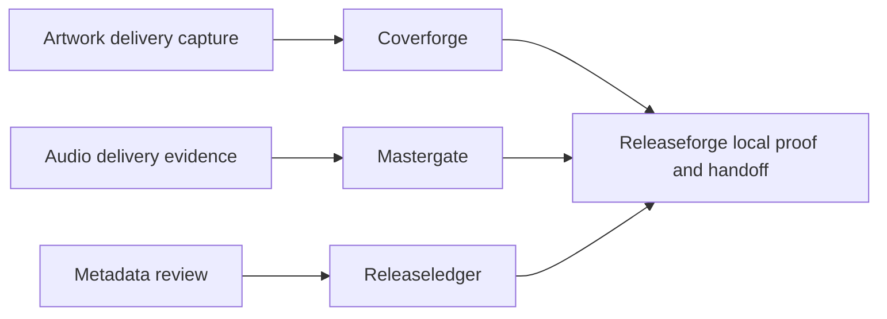

# GitHub Profile Release-Workflow Launchpad Implementation Plan

> **For agentic workers:** REQUIRED SUB-SKILL: Use superpowers:subagent-driven-development (recommended) or superpowers:executing-plans to implement this plan task-by-task. Steps use checkbox (`- [ ]`) syntax for tracking.

**Goal:** Make the GitHub profile repository a concise, honest entry point to the local-first release workflow, with one safe Releaseforge demo route and a clear map of the core tools.

**Architecture:** Keep the change static and Markdown-only. Add `START_HERE.md` for the safe trial path, then reshape the profile `README.md` around a compact workflow diagram, accessible tool table, and explicit draft/privacy boundaries. Validate local and GitHub targets through deterministic shell checks and GitHub CLI metadata.

**Tech Stack:** GitHub profile Markdown, Mermaid flowchart syntax, GitHub CLI, POSIX shell checks.

## Global Constraints

- Build on `codex/profile-launchpad`, with `codex/profile-portfolio` as the draft-PR base.
- Retain Gabriel García Alonso's artist/label identity: Hologram People, Lack of Fate, and Fate Through.
- Describe Releaseforge literally as a draft local-first workflow; do not call it released, hosted, paid, compliant, approved, production-ready, or distributor accepted.
- State that tool checks do not establish rights, ownership, approval, platform acceptance, or public-release readiness.
- Do not add a deployment, GitHub Pages configuration, tracking, analytics, sign-up form, issue creation, payment flow, outreach action, user-data upload, or account setting change.
- Do not include source media, hashes, release metadata, client data, credentials, file URIs, or absolute local paths.
- Use the current public Releaseforge draft PR #1 and its `codex/initial-implementation` branch only after live GitHub verification.
- Keep the PR draft and stacked; do not merge, retarget, or mark its parent ready.

---

### Task 1: Add the privacy-safe start-here route

**Files:**
- Create: `START_HERE.md`

**Interfaces:**
- Consumes: the current public Releaseforge draft PR #1, development branch `codex/initial-implementation`, and its documented `releaseforge demo` command.
- Produces: a self-contained profile-level guide that links readers to the public draft and gives them a synthetic local trial path without asking for real release data.

- [ ] **Step 1: Write the guide before adding it to the profile README**

Create `START_HERE.md` with these sections and exact boundaries:

````markdown
# Start here

## Try one safe workflow first

[Releaseforge](https://github.com/notgabriels-sys/releaseforge/pull/1) is the
flagship experiment: a local proof workflow for the moment before a delivery
handoff or distributor upload. It is currently a draft pull request, not a
hosted service or a release-compliance authority.

Read the [draft review](https://github.com/notgabriels-sys/releaseforge/pull/1)
or inspect the [current development branch](https://github.com/notgabriels-sys/releaseforge/tree/codex/initial-implementation).
To run the documented synthetic demo locally:

```bash
git clone --branch codex/initial-implementation --single-branch https://github.com/notgabriels-sys/releaseforge.git
cd releaseforge
python3 -m venv .venv
. .venv/bin/activate
python -m pip install .
releaseforge demo ./releaseforge-demo
```

The installation may retrieve the package's normal dependency. The demo then
creates a new local directory with illustrative media and proof packets. It
does not inspect, upload, rename, delete, or modify a real release folder.

## How the core tools connect

| Workflow lane | Tool | Local role |
| --- | --- | --- |
| Artwork delivery | [Coverforge](https://github.com/notgabriels-sys/albumdesign) | Preflights artwork and can create a portable delivery capture. |
| Audio delivery | [Mastergate](https://github.com/notgabriels-sys/mastergate) | Measures a declared PCM WAV batch against a chosen delivery contract. |
| Metadata review | [Releaseledger](https://github.com/notgabriels-sys/releaseledger) | Checks declared release metadata and prepares a reviewable handoff dossier. |
| Evidence synthesis | [Releaseforge](https://github.com/notgabriels-sys/releaseforge/pull/1) | Creates a local proof packet and can reconcile documented compatible captures. |

The tools can be used independently. Where a documented compatible capture is
available, Releaseforge can read it locally into a companion handoff packet;
it does not install, call, upload to, or otherwise contact another tool. The
workflow still needs human review for rights, approvals, and the actual delivery
destination.

## Pilot safely

The [privacy-minimal pilot protocol](https://github.com/notgabriels-sys/releaseforge/blob/codex/initial-implementation/docs/PILOT.md)
explains how to test a genuine local handoff without giving away release
material. Do not upload or paste music, artwork, project files, hashes, source
packets, release or client metadata, credentials, or payment information into
public feedback, issues, chat, or email.

A local check can clarify a handoff. It does not establish rights, ownership,
approval, platform acceptance, or public-release readiness.
````

- [ ] **Step 2: Check that the proposed local trial route is structurally safe**

Run:

```bash
test -f START_HERE.md
rg -n 'releaseforge/pull/1|codex/initial-implementation|releaseforge demo|does not inspect, upload, rename, delete, or modify' START_HERE.md
rg -n -i 'file://|/Users/|/private/|password|api[_-]?key|token' START_HERE.md && exit 1 || true
```

Expected: every required Releaseforge route/boundary appears and no local path
or credential-like text is present.

- [ ] **Step 3: Verify the live GitHub targets before treating the links as current**

Run:

```bash
gh pr view --repo notgabriels-sys/releaseforge 1 \
  --json number,state,isDraft,headRefName,url
gh api repos/notgabriels-sys/releaseforge/branches/codex/initial-implementation \
  --jq '.name'
```

Expected: PR #1 is open and draft, its head is `codex/initial-implementation`,
and the branch endpoint returns that exact branch name.

- [ ] **Step 4: Commit the guide**

```bash
git add START_HERE.md
git commit -m "docs: add profile start-here guide"
```

### Task 2: Reframe the profile README around one workflow

**Files:**
- Modify: `README.md`

**Interfaces:**
- Consumes: `START_HERE.md` and public repository links for Coverforge,
  Mastergate, Releaseledger, Sleeveproof, and the Releaseforge draft.
- Produces: a profile README whose prominent link is `START_HERE.md`, whose
  visual map is duplicated by prose/table content, and whose status language is
  literal.

- [ ] **Step 1: Replace the fragmented opening with a single start route**

Keep the identity paragraph, then add:

```markdown
## Start here

The strongest current experiment is **Releaseforge**: a local proof workflow
for the point before a delivery handoff or distributor upload. It is under
[draft review](https://github.com/notgabriels-sys/releaseforge/pull/1), so the
useful first step is its synthetic local demo rather than a claim of a finished
service.

→ **[Open the safe start-here guide](START_HERE.md)**
```

Do not use launch, revenue, compliance, or public-release claims.

- [ ] **Step 2: Add a compact visual map plus an accessible explanation**

Insert this Mermaid diagram immediately before the tool table:

````markdown

````

Follow it with one sentence stating that the arrows show a possible local
evidence flow, not automatic integration, a mandated stack, or external
approval.

- [ ] **Step 3: Replace the bullet list with a four-row tool table**

Use the columns `Workflow lane`, `Tool`, `Local role`, and `State`. Rows must
accurately say:

| Workflow lane | Tool | Local role | State |
| --- | --- | --- | --- |
| Visual delivery | Coverforge | Preflights artwork and can create a portable delivery capture. | Supporting local tool. |
| Audio delivery | Mastergate | Measures a declared PCM WAV batch against a chosen delivery contract. | Supporting local tool. |
| Metadata review | Releaseledger | Checks declared release metadata and prepares a reviewable handoff dossier. | Supporting local tool. |
| Evidence synthesis | Releaseforge | Creates a local proof packet and can reconcile documented compatible captures. | Draft PR; synthetic demo available. |

Each tool name is a Markdown link to its repository, except Releaseforge which
links to its draft PR. Add Sleeveproof beneath the table as a separate optional
visual-review utility, without presenting it as a required delivery stage.

- [ ] **Step 4: Preserve identity and harden the boundaries**

Retain the existing `Artist and label work` and `Working principles` sections.
In the working principles, retain the distinction between local measurements,
declarations, approvals, and unknowns. Add the narrow line:

```markdown
- A local packet can make a handoff clearer; it never establishes rights,
  approval, platform acceptance, or public-release readiness.
```

- [ ] **Step 5: Validate profile structure and prohibited claims**

Run:

```bash
test -f START_HERE.md
rg -n 'Open the safe start-here guide|flowchart LR|possible local evidence flow|Draft PR; synthetic demo available|Hologram People|Lack of Fate|Fate Through' README.md
rg -n -i '\bguarantee(d)?\b|\bcertif(y|ied|ication)\b|\bdistributor[- ]accepted\b' README.md START_HERE.md && exit 1 || true
rg -n -i 'file://|/Users/|/private/|password|api[_-]?key|token' README.md START_HERE.md && exit 1 || true
git diff --check
```

Expected: all required launchpad anchors are present; prohibited claims,
credentials, local paths, and whitespace errors are absent.

- [ ] **Step 6: Commit the profile refresh**

```bash
git add README.md
git commit -m "docs: consolidate release workflow launchpad"
```

### Task 3: Verify the rendered-source contract and publish a draft child PR

**Files:**
- Verify: `README.md`, `START_HERE.md`, `docs/superpowers/specs/2026-08-15-profile-launchpad-design.md`, and the profile repository branch state.

**Interfaces:**
- Consumes: clean local branch `codex/profile-launchpad` and base
  `codex/profile-portfolio`.
- Produces: a normal pushed branch and draft PR stacked on the existing profile
  draft, with no profile setting or deployment change.

- [ ] **Step 1: Run final local and live-link validation**

Run:

```bash
git diff --check origin/codex/profile-portfolio...HEAD
rg -n 'https://github.com/notgabriels-sys/' README.md START_HERE.md
gh repo view notgabriels-sys/albumdesign --json nameWithOwner,url
gh repo view notgabriels-sys/mastergate --json nameWithOwner,url
gh repo view notgabriels-sys/releaseledger --json nameWithOwner,url
gh repo view notgabriels-sys/sleeveproof --json nameWithOwner,url
gh pr view --repo notgabriels-sys/releaseforge 1 --json url,state,isDraft,headRefName
```

Expected: the diff is whitespace clean, every external link uses the correct
owner, each repository endpoint resolves, and Releaseforge is still presented
as an open draft whose head branch is the demo source.

- [ ] **Step 2: Review the exact public-facing diff**

Run:

```bash
git diff --check origin/codex/profile-portfolio...HEAD
git diff --word-diff=plain origin/codex/profile-portfolio...HEAD -- README.md START_HERE.md
```

Expected: concise, human wording; no inflated adoption, revenue, release,
hosting, or compliance claim; no sensitive data; and no change outside the
static launchpad/spec/plan files.

- [ ] **Step 3: Check the base before publishing**

Run:

```bash
git fetch origin --prune
git rev-parse origin/codex/profile-portfolio
git rev-list --left-right --count origin/codex/profile-portfolio...HEAD
git status --short --branch
```

Expected: the base is confirmed and the branch is ahead without uncommitted
changes or a need for force-push.

- [ ] **Step 4: Push normally and open the stacked draft PR**

Run:

```bash
git push --set-upstream origin codex/profile-launchpad
gh pr create --repo notgabriels-sys/notgabriels-sys \
  --head codex/profile-launchpad \
  --base codex/profile-portfolio \
  --draft \
  --title "docs: add release workflow launchpad"
```

The PR body must mention the safe synthetic-demo route, the static/local-only
boundary, the profile tool map, exact link validation, and that the PR remains
a draft child of profile PR #1. It must not claim that a GitHub profile setting,
GitHub Pages deployment, hosted product, outreach, or revenue action occurred.

- [ ] **Step 5: Confirm literal GitHub state**

Run:

```bash
gh pr view --repo notgabriels-sys/notgabriels-sys codex/profile-launchpad \
  --json number,url,state,isDraft,baseRefName,headRefName,mergeStateStatus,statusCheckRollup
```

Expected: open, draft, base `codex/profile-portfolio`, and no merge/ready
action taken.
